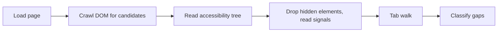

# at-agent

A command-line tool that checks web pages for accessibility problems. It runs axe-core scans, compares a page's DOM against the browser's accessibility tree to find controls that screen reader and keyboard users can't reach, walks the page with the Tab key to look for keyboard traps, and can hand the browser to an LLM agent that tries to finish a task (like "add an item to the cart") while auditing along the way.

Built by Matthew Li, Pius Lee, Seunghyun Bae and Michael Li. The repository is named accessibility-agent; the command it installs is `at-agent`.

## How it works

The main code is four packages in an npm workspace, each one built on the one before it:

```
browser  ->  accessibility  ->  agent  ->  cli
```

The CLI (`packages/cli/src/cli.ts`, built with commander) has three commands. Each one is described below, followed by the keyboard walk they share and the benchmark setup used to test the checkers.

### `audit <url>`: rule-based scan

1. `BrowserClient` (`packages/browser/src/client.ts`) launches headless Chromium through Playwright and opens the page.
2. `runAxe` (`packages/accessibility/src/axe.ts`) injects the axe-core script into the page and runs it, optionally limited to certain WCAG tags (`--tags wcag2a wcag2aa`).
3. `Auditor` (`packages/accessibility/src/auditor.ts`) turns the results into a list of violations and counts them by impact (critical, serious, moderate, minor).
4. The CLI prints a text report or JSON (`--json`). It exits with code 1 when there are critical or serious violations, so it can fail a CI job.

### `gaps <url>`: DOM vs. accessibility tree

A rule scanner only looks at what the page declares. This command looks for elements that _act_ interactive but are broken for assistive technology, for example a `<div>` with a click handler that a screen reader never announces. The pipeline lives in `crawlPageWithGapDetection` (`packages/accessibility/src/gaps/detect.ts`):



1. **Load.** Opens the URL and waits a fixed few seconds so dynamic content can render. It also writes a random marker onto `window`, which is used later to tell whether the page reloaded or navigated during the check.
2. **Crawl the DOM** (`gaps/dom-crawler.ts`). Over a Chrome DevTools Protocol (CDP) session it collects candidates: native controls, elements with interactive ARIA roles or `tabindex`, inline handlers like `onclick`, class names that hint at buttons, and plain elements that only have event listeners attached (including React handlers, which are found by scanning React's internals).
3. **Read the accessibility tree** (`gaps/ax-tree.ts`) with CDP's `Accessibility.getFullAXTree`. This happens after the crawl so that every candidate already existed when the tree was read.
4. **Filter and gather signals.** Hidden candidates (hidden inputs, no layout box, CSS-hidden) are dropped. For the rest it records interactivity signals (click handler, `cursor: pointer`, `tabindex`, `aria-expanded`, and so on) and focus facts (disabled, part of a widget that handles arrow keys).
5. **Tab walk.** Runs the scripted keyboard walk (see below) on the same page load to learn which elements the keyboard actually reaches.
6. **Check the walk is trustworthy.** If the marker is gone or crawled elements were removed from the document, the walk no longer describes the crawled page, so "not focusable" is reported as _not assessed_ instead of guessed.
7. **Classify** (`gaps/gap-detector.ts`). Each candidate is scored by `isLikelyInteractive` (weighted signals with a threshold), matched to its accessibility node by CDP `backendNodeId`, and labelled as one of `missing_from_a11y_tree`, `no_accessible_name`, `wrong_role`, `not_focusable`, or `hidden_but_interactive`. Every gap carries a severity, the WCAG criteria it maps to, the evidence, and a suggested fix. An element that Tab never landed on still counts as reachable if it belongs to a radio group or an arrow-key widget that Tab did enter, since those are reached with the arrow keys, not Tab (`gaps/keyboard.ts`).

The CLI also reports which page reads failed, so a clean result can be told apart from an incomplete one. Like `audit`, it exits with code 1 when there are critical or serious gaps.

### `flow <url> --goal "..."`: LLM-driven task

The `Agent` class (`packages/agent/src/agent.ts`) runs a step loop:

1. `generateAction` (`packages/agent/src/openai.ts`) sends the goal, the history of previous steps, and the latest observation to the OpenAI chat completions API in JSON mode. The model picks one action. The reply is validated with a Zod schema (`packages/agent/src/types.ts`).
2. `executeAction` (`packages/agent/src/tools.ts`) carries it out. The actions are `navigate`, `observe`, `click`, `fill`, `audit`, `tab`, `checkKeyboard` and `done`.
3. Click and fill targets are written as `role named "name"` (for example `button named "Submit"`) and resolved with Playwright's `getByRole`. That way the agent finds elements through the same roles and names a screen reader would expose, not through CSS selectors. A click target in any other form falls back to matching visible text.
4. `observe` summarizes the page from Playwright's ARIA snapshot: title, headings and landmarks (`ScreenReaderSimulator` in `packages/accessibility/src/screen-reader.ts`).
5. `audit` runs axe-core on the current state and collects the violations. `checkKeyboard` runs the Tab walk and the keyboard judges described below.
6. The loop stops on `done` or after `--max-steps` (default 20). With `--headed` the browser is visible and the target element is outlined before each click or fill.

### The Tab walk and keyboard judges

`runTabWalk` (`packages/accessibility/src/tab-walk.ts`) presses Tab through the page and records where focus lands after every press. It never decides pass or fail itself; separate judges read its record.

- Before starting, it counts the focusable stops (light DOM, open shadow roots, same-origin iframes) and sets the number of presses to cover about five full laps of the page.
- After each press it reads focus twice: right away and again after a short settle delay. Each press records whether focus wrapped back to the start, was lost, or landed in a new document.
- It also watches the page for a moment _before_ the first press. This idle baseline catches pages that redirect or change on their own, so those changes are not blamed on the keyboard.
- If the walk never wraps, it tries to get out by pressing Escape and then the opposite Tab direction.

The judges:

- `keyboard-trap.ts` (WCAG 2.1.2): a trap means focus never reaches the end of the page _and_ neither Escape nor reverse Tab gets out. Focus going around in a loop is not treated as a trap on its own, since every normal page does that.
- `context-change.ts` (WCAG 3.2.1): flags a URL change when focus arrives on an element, or focus being pulled away the moment it arrives. Changes the walk can't tie to a specific keypress are recorded as unattributed and not reported.
- `focus-indicator.ts` (WCAG 2.4.7): compares an element's computed styles focused vs. unfocused, and confirms with screenshots. It is exported from the package but not wired into the CLI yet.

Each judge returns `pass`, `fail` or `undetermined` with a reason. All the long-running checks are wrapped in `failOnCrash` (`renderer-crash.ts`), so a crashed browser tab fails the check instead of hanging it.

### Benchmark (`bench/`)

The checkers are tested against labelled pages so that a code change can be compared with the previous version.

1. **Seeded pages.** `bench/seed.ts` takes small static base pages and applies one defect operator (M1 to M13, defined in `bench/corpus/dev/operators.ts`) to one element, writing the variant page and its expected label. `--check` reloads every variant and confirms exactly one element changed.
2. **Real pages.** `bench/fetch-bad.ts` downloads the W3C Before-and-After Demonstration site and pins it with a sha256 manifest. Its labels (`bench/corpus/test/bad-labels.json`) come from two separate readings of the W3C reports.
3. **Run.** `bench/run.ts` gives every tool a fresh browser context per page: the gap detector, the Tab walk plus judges, a replay of the older checker (`bench/legacy.ts`), and axe-core. It writes a `summary.json` stamped with the git commit.
4. **Report.** `bench/report.ts` turns the summaries into a Markdown report; `bench/stats.ts` holds the interval math.
5. **Human checks.** `bench/spotcheck.ts` draws a sample of labels for a person to re-check, and `bench/spotcheck-ui.ts` serves a small local page for doing that. `bench/blind-labels.ts` builds a shuffled worklist with the source tool hidden.
6. **Parity.** `bench/parity/` compares the ported gap detector against the original `taskgen` version, and `divergence-ledger.ts` lists every expected difference along with the fix that explains it.

### CI integrations

- `integrations/github-actions/audit` and `integrations/github-actions/flow` are composite GitHub Actions that run the CLI with `--json`, read the result with `jq`, set step outputs and write a job summary. The audit action fails the job when violations reach its `fail-on` impact level; the flow action fails it when the agent does not reach the goal. Their shell scripts have tests (`*.test.sh`) that run in `.github/workflows/test-actions.yml`.
- `integrations/jenkins` (a Java/Maven Jenkins plugin), `integrations/azure-devops`, `integrations/gitlab-ci`, `integrations/github-actions/accessibility-agent` and `.github/actions/accessibility-agent` were written for the earlier version of the agent. They call an `npm run start:agent-cli` script that the rebuilt workspace no longer has.

## Project layout

```
packages/
  browser/         Playwright wrapper: launch, navigate, role-based lookup, ARIA snapshot
  accessibility/   axe-core audit, gap detector, Tab walk and WCAG judges
  agent/           LLM step loop and the actions it can take
  cli/             at-agent command (audit, gaps, flow)
bench/             labelled test pages, benchmark runner, report generator, spot-check tools
integrations/      GitHub Actions, Jenkins plugin, Azure DevOps, GitLab CI
taskgen/           original site crawler, gap detector and task generator (the gap detector was ported from here)
apps/              earlier prototypes: a CDP-based virtual screen reader and a web UI
docs/plans/        design notes for each layer of the rebuild
```

`Dockerfile.rerun-worker` and the `fly.*.toml` files are Fly.io deploy configs from the earlier version and point at folders that are not in this tree.

## Tech stack

- TypeScript on Node.js, npm workspaces
- Playwright (Chromium) and the Chrome DevTools Protocol
- axe-core
- OpenAI API (`openai` SDK) for the agent
- Zod for schemas, commander for the CLI
- Vitest for tests
- Bash and `jq` for the GitHub Actions; Java and Maven for the Jenkins plugin

## Running it

Uses Node.js 20 (the version the CI actions set up).

```bash
npm install
npx playwright install chromium
npm run build:packages
```

Rule-based audit and gap detection (no API key needed):

```bash
npm run at-agent -- audit https://example.com
npm run at-agent -- audit https://example.com --tags wcag2a wcag2aa --json
npm run at-agent -- gaps https://example.com --json
```

LLM-driven flow test. Set `OPENAI_API_KEY` in your shell or in a `.env` file (see `.env.example`), or pass `--api-key`:

```bash
npm run at-agent -- flow https://example.com --goal "find the contact page" --max-steps 15 --headed
```

Tests:

```bash
npm run test:packages     # unit tests for the four packages
npx vitest run bench      # benchmark tests (some launch Chromium)
```

Benchmark scripts are run directly with `tsx`, for example `npx tsx bench/seed.ts` and `npx tsx bench/serve.ts`. Usage notes are at the top of each file.
